# Diagrama de clases - Avance 2 (integrado al Avance 1)

GitHub dibuja este diagrama automáticamente. Para exportarlo como imagen, pegar el bloque en https://mermaid.live.

```mermaid
classDiagram
    direction TB

    class ColaDinamica {
        <<profesor>>
        -Nodo frente
        -Nodo fin
        +encolar(Paciente dato) void
        +desencolar() Paciente
        +estaVacia() boolean
        +imprimirCola() void
    }
    class ColaPacientes {
        +atenderSiguiente() Paciente
        +contarPacientes() int
        +buscarPorFicha(String) Paciente
        +eliminarPorFicha(String) Paciente
    }
    class NodoCola["colas.Nodo"] {
        <<profesor>>
        -Paciente dato
        -Nodo siguiente
    }
    ColaDinamica <|-- ColaPacientes
    ColaDinamica o-- NodoCola
    NodoCola --> Paciente

    class PilaDinamica {
        <<profesor>>
        -Nodo cima
        +apilar(Queja valor) void
        +desapilar() Nodo
        +retornaCima() Nodo
        +esVacia() boolean
        +imprimirPila() void
        +retornaTamaño() int
    }
    class PilaQuejas {
        +registrarAbandono(Paciente, String) Queja
        +ultimaQueja() Queja
    }
    class NodoPila["pilas.Nodo"] {
        <<profesor>>
        -Queja dato
        -Nodo abajo
    }
    PilaDinamica <|-- PilaQuejas
    PilaDinamica o-- NodoPila
    NodoPila --> Queja

    class ListaSimple {
        <<profesor>>
        -Nodo cabeza
        +insertarOrdenado(CitaBitacora) void
        +eliminarNodo(String) void
        +buscarCita(String) boolean
        +recorrerLista() void
    }
    class BitacoraCitas {
        +registrarCita(CitaBitacora) void
        +estaVacia() boolean
        +contarCitas() int
    }
    class NodoLista["listas.Nodo"] {
        <<profesor>>
        -CitaBitacora dato
        -Nodo siguiente
    }
    ListaSimple <|-- BitacoraCitas
    ListaSimple o-- NodoLista
    NodoLista --> CitaBitacora

    class ListaDobleCircular {
        <<profesor>>
        -NodoDoble primero
        -NodoDoble ultimo
        +insertarOrdenado(Expediente) void
    }
    class ExpedienteUnico {
        +registrarExpediente(Expediente) void
        +buscarPorCedula(String) Expediente
        +estaVacia() boolean
        +contarExpedientes() int
    }
    class NodoDoble {
        <<profesor>>
        -NodoDoble anterior
        -Expediente dato
        -NodoDoble siguiente
    }
    ListaDobleCircular <|-- ExpedienteUnico
    ListaDobleCircular o-- NodoDoble
    NodoDoble --> Expediente

    class ListaCircular {
        <<profesor>>
        -NodoSimple primero
        -NodoSimple ultimo
        +insertarOrdenado(RegistroHistorico) void
    }
    class HistoricoCitas {
        +agregarCita(CitaHistorica) void
        +estaVacia() boolean
        +contarCitas() int
    }
    class HistoricoMedicamentos {
        +agregarMedicamento(MedicamentoPrescrito) void
        +estaVacia() boolean
        +contarMedicamentos() int
    }
    class NodoSimple {
        <<profesor>>
        -RegistroHistorico dato
        -NodoSimple siguiente
    }
    ListaCircular <|-- HistoricoCitas
    ListaCircular <|-- HistoricoMedicamentos
    ListaCircular o-- NodoSimple
    NodoSimple --> RegistroHistorico

    class Paciente {
        -String numeroFicha
        -String cedula
        -String nombre
        -Date fechaHoraLlegada
        -String tipoPaciente
        +isPreferencial() boolean
        +cedulaANumero(String)$ long
    }
    class Queja {
        -String numeroFicha
        -String cedula
        -String nombre
        -String motivo
        -Date fechaHoraAbandono
    }
    class CitaBitacora {
        -String numeroFicha
        -String cedula
        -String nombre
        -Date fechaLlegada
        -Date fechaAtencion
        +getCedulaNumerica() long
        +getSegundosEspera() long
    }
    class Expediente {
        -String cedula
        -String nombre
        -int edad
        -String genero
        -HistoricoCitas historicoCitas
        -HistoricoMedicamentos historicoMedicamentos
        +getCedulaNumerica() long
    }
    class RegistroHistorico {
        <<abstract>>
        -Date fecha
        +getMarcaTiempo() long
        +getDetalle()* String
    }
    class CitaHistorica {
        -String nombreDoctor
        -String diagnostico
        +getDetalle() String
    }
    class MedicamentoPrescrito {
        -String medicamento
        +getDetalle() String
    }
    RegistroHistorico <|-- CitaHistorica
    RegistroHistorico <|-- MedicamentoPrescrito
    Expediente *-- HistoricoCitas
    Expediente *-- HistoricoMedicamentos

    class GestorAtencion {
        -ColaPacientes colaRegular
        -ColaPacientes colaPreferencial
        -int preferencialesSeguidos
        +agregarPaciente(Paciente) void
        +atenderPaciente() Paciente
        +hayPacientes() boolean
    }
    class GestionAbandono {
        -GestorAtencion gestor
        -PilaQuejas pilaQuejas
        +abandonar(String ficha, String motivo) Queja
    }
    class GestorCitas {
        -ExpedienteUnico expedienteUnico
        -BitacoraCitas bitacora
        +buscarExpediente(String) Expediente
        +crearExpediente(Paciente, int, String) Expediente
        +registrarCita(Paciente, Expediente, Date, String, String) void
        +registrarMedicamento(Expediente, String) void
    }
    GestorAtencion *-- "2" ColaPacientes
    GestionAbandono *-- PilaQuejas
    GestionAbandono --> GestorAtencion
    GestorCitas *-- ExpedienteUnico
    GestorCitas *-- BitacoraCitas

    class GRUPO4PFA1 {
        +main(String[] args)$ void
    }
    class Menus {
        +menuPrincipal() void
        +menuGestionLlegada() void
    }
    class Consola {
        +leerTexto(String) String
        +leerObligatorio(String) String
        +leerCedula(String) String
        +leerEntero(String, int, int) int
        +pintar(String, String) String
        +formatearFecha(Date) String
    }
    class PantallaFichas {
        -int contadorRegular
        -int contadorPreferencial
        +seleccionarFicha() void
    }
    class PantallaAtencion {
        +atenderPaciente() void
    }
    class PantallaAbandono {
        +abandonarCola() void
    }
    class PantallaConsultas {
        +mostrarFichasPendientes() void
        +mostrarQuejasRecibidas() void
    }
    class PantallaBitacora {
        +mostrarBitacora() void
    }
    class PantallaExpedientes {
        +consultarExpedientes() void
    }
    class PantallaAyuda {
        +mostrarAyuda() void
    }
    GRUPO4PFA1 ..> Menus : crea
    Menus --> Consola
    Menus --> PantallaFichas
    Menus --> PantallaAtencion
    Menus --> PantallaAbandono
    Menus --> PantallaConsultas
    Menus --> PantallaBitacora
    Menus --> PantallaExpedientes
    Menus --> PantallaAyuda
    PantallaFichas --> GestorAtencion
    PantallaAtencion --> GestorAtencion
    PantallaAtencion --> GestorCitas
    PantallaAbandono --> GestionAbandono
    PantallaConsultas --> GestorAtencion
    PantallaConsultas --> GestionAbandono
    PantallaBitacora --> GestorCitas
    PantallaExpedientes --> GestorCitas
```

Las clases marcadas `<<profesor>>` son las vistas en clase (solo se ajustó el dato del Nodo). Las flechas con triángulo son herencia.

